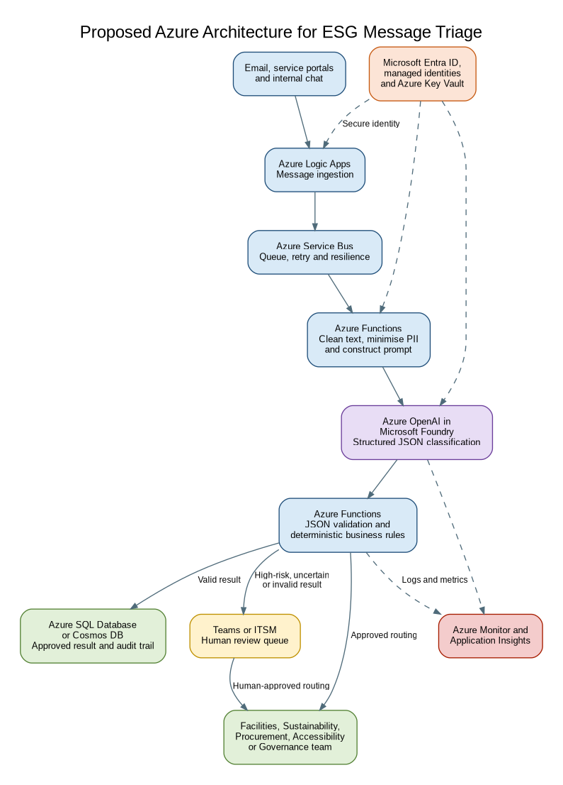

# Q3 – LLM-Based ESG Message Triage

## Purpose

This experiment prototypes an automated system for classifying and triaging ESG-related operational messages. The system extracts an issue category, urgency, sentiment, follow-up requirement, recommended team, escalation reason, data-sensitivity risk and concise summary.

The experiment compares Gemini 2.5 Flash through Google Vertex AI with a transparent Python rule-based baseline.

## Experimental configuration

- LLM: Gemini 2.5 Flash
- Platform: Google Vertex AI
- Region: australia-southeast1
- Temperature: 0
- Output format: Schema-controlled JSON
- Baseline: Deterministic Python keyword and business-rule classifier
- Test cases: Three realistic ESG operational messages
- Repeated testing: Three Gemini runs per message

No API keys or credentials are stored in this repository.

## Test scenarios

| Test | Scenario | Expected category | Expected urgency | Expected team |
|---|---|---|---|---|
| T1 | Water approaching an electrical outlet | WATER_AND_UTILITIES | CRITICAL | Facilities |
| T2 | Supplier refusing to provide sustainability-policy evidence | SUSTAINABLE_PROCUREMENT | MEDIUM | Procurement |
| T3 | Blocked accessible entrance preventing independent access | ACCESSIBILITY | HIGH | Accessibility |

Expected classifications were defined before running either system.

## Prompt improvements

The supplied prompt was revised to include:

- eight controlled issue categories;
- explicit urgency and sensitivity criteria;
- approved team names;
- a formal JSON response schema;
- confidence and human-review fields;
- rules against inventing unsupported facts;
- treatment of message content as untrusted input;
- mandatory human review for high-risk cases.

## Results

Gemini and the rule-based baseline each achieved 21 correct exact matches from 21 evaluated controlled fields across the three test messages.

| System | Correct fields | Total fields | Accuracy |
|---|---:|---:|---:|
| Gemini | 21 | 21 | 100% |
| Rule-based baseline | 21 | 21 | 100% |

This result does not demonstrate production-level accuracy. The dataset was small and deliberately contained clear category terminology. The baseline rules were also designed around language represented in the test cases, creating selection and rule-design bias.

## Consistency test

Gemini was run three times for every message:

- T1: seven of seven core fields remained consistent.
- T2: six of seven core fields remained consistent.
- T3: seven of seven core fields remained consistent.

For T2, `data_sensitivity_risk` changed from `MEDIUM` in two runs to `LOW` in one run. This shows that temperature zero and schema-controlled output do not guarantee identical semantic decisions.

The variation did not change urgency, routing or follow-up, but it could affect access controls, privacy handling and retention decisions.

## Critical evaluation

The rule-based baseline was deterministic, inexpensive and explainable, but depends strongly on expected keywords and may fail on indirect descriptions, spelling errors, multilingual input or messages containing multiple issues.

Gemini generated more context-sensitive summaries and escalation reasons, but its supplier-sensitivity classification varied. The model also assigned confidence values of 0.95, which are self-reported model outputs rather than calibrated probabilities.

Potential biases include test-selection bias, rule-design bias, English-language bias, accessibility under-escalation and treating unverified supplier concerns as confirmed misconduct.

## Readiness recommendation

The prototype is suitable for a controlled pilot with human oversight but is not ready for autonomous production use.

Human review should be mandatory for:

- HIGH or CRITICAL urgency;
- sensitive or ambiguous messages;
- low-confidence classifications;
- invalid JSON or business-rule conflicts;
- safety, accessibility, governance or supplier allegations.

The LLM should support triage and prioritisation rather than make final safety, compliance or disciplinary decisions.

## Proposed Azure architecture

The proposed workflow uses:

1. Azure Logic Apps for message ingestion.
2. Azure Service Bus for durable queuing and retries.
3. Azure Functions for preprocessing and data minimisation.
4. Azure OpenAI in Microsoft Foundry for structured classification.
5. Azure Functions for JSON validation and deterministic safety rules.
6. Azure SQL Database or Cosmos DB for approved results and audit records.
7. Microsoft Teams or an ITSM platform for human review.
8. Microsoft Entra ID, managed identities and Key Vault for security.
9. Azure Monitor and Application Insights for operational monitoring.

## Repository files

- `Q3_ESG_Message_Triage.ipynb` – complete Colab/Jupyter experiment
- `q3_gemini_results.csv` – structured Gemini outputs
- `q3_gemini_raw_results.json` – full Gemini output records
- `q3_rule_based_results.csv` – baseline classifications
- `q3_rule_based_raw_results.json` – full baseline output records
- `q3_field_level_evaluation.csv` – field-level exact-match assessment
- `q3_model_comparison.csv` – compact model comparison
- `q3_gemini_consistency_runs.csv` – nine repeated-run records
- `q3_consistency_summary.csv` – consistency by test case
- `q3_t2_consistency_variation.csv` – observed supplier-sensitivity variation
- `q3_azure_esg_triage_architecture.png` – proposed Azure architecture
